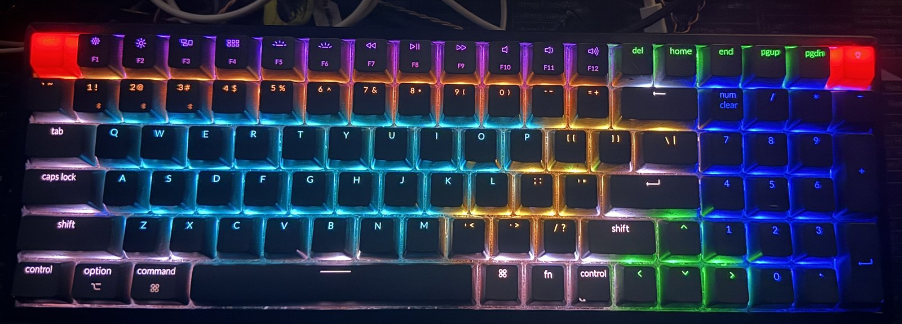

# QMK con Bluetooth funcionando en el Keychron K4 V2 (RGB)



Firmware [SonixQMK](https://github.com/SonixQMK/qmk_firmware) para el
**Keychron K4 V2 RGB** que añade lo que le faltaba a QMK en este teclado: el
**Bluetooth**. Incluye además soporte para VIA, un efecto de luces que pinta
cada grupo de teclas de un color (el de la foto) y scripts para macOS que
respaldan, flashean y restauran el firmware original.

**Read in English:** [README.md](README.md)

## Qué incluye

| Función | Detalle |
|---|---|
| **Bluetooth** | 3 perfiles, emparejamiento, nivel de batería en la fila de números, aviso de batería baja, suspensión automática |
| **Interruptor Mac / Windows** | El interruptor lateral elige una capa Mac o una Windows (Option/Command, funciones de macOS en la fila F) |
| **VIA** | Cambiar teclas y luces desde [usevia.app](https://usevia.app) sin recompilar |
| **Luces por zonas** | Efecto por defecto: letras, números, fila F, símbolos, modificadores, navegación y numérico, cada uno con su color |
| **Instalación segura** | Los scripts comprueban tu firmware original antes de flashear y pueden devolverlo cuando quieras |

## Estado

| | |
|---|---|
| ✅ Probado en hardware | K4 V2 **ANSI** RGB, firmware VIA, macOS: escritura por cable, VIA, luces por zonas, emparejamiento Bluetooth (perfil 1) y escritura por Bluetooth |
| ⚠️ Compila, falta confirmar en hardware | Perfiles Bluetooth 2 y 3, indicador de batería (Fn + B), suspensión, la distribución **ISO**, Windows como equipo |

Si pruebas algo de lo que falta, abre un issue y cuenta cómo te fue.

## Antes de empezar

- **Teclado:** K4 **V2 RGB**. La versión de luz blanca no está cubierta. Quita la
  barra espaciadora: la placa debe decir `FK52332UB-G Ver10` y tener dos
  contactos **BOOT**.
- **ANSI o ISO:** ANSI tiene el Enter horizontal de una fila. ISO tiene el Enter
  alto en forma de "L" invertida y una tecla extra junto al Shift izquierdo (por
  ejemplo, el teclado en español).
- **Ordenador:** un Mac (Apple Silicon o Intel) con [Homebrew](https://brew.sh).
  Para Windows o Linux, ver [Otros sistemas operativos](#otros-sistemas-operativos).

> **Riesgo:** flashear siempre tiene un riesgo pequeño. El chip SN32F248B tiene
> el bootloader grabado en ROM, así que puentear los contactos BOOT siempre
> permite volver a flashear, incluso el firmware original. Usa un buen cable,
> no desconectes durante el flasheo y sigue los pasos en orden.

## 1. Preparar las herramientas (una sola vez)

```bash
git clone https://github.com/wilmermolinac/QMK-on-K4V2.git
cd QMK-on-K4V2
scripts/setup-macos.sh
```

Descarga todo dentro de `build/` (ignorado por git): SonixQMK en el commit
probado, el toolchain ARM oficial de QMK, la CLI de QMK en un entorno Python y
[SonixFlasherC](https://github.com/SonixQMK/SonixFlasherC), el flasheador para
la terminal. Solo instala `libusb` y `pkgconf` con Homebrew si te faltan.

## 2. Entrar en modo bootloader

1. Pon el interruptor lateral en **Cable**.
2. Desconecta el cable USB.
3. Quita la barra espaciadora y puentea los dos contactos **BOOT** con unas
   pinzas o un clip. Basta con tocar los dos a la vez, no hay que meter nada.
4. Conecta el cable sin dejar de puentear y suelta después de 1–2 segundos.

**Cómo saber que funcionó:** las luces del teclado quedan apagadas y no escribe.
Para confirmarlo, lista los dispositivos conectados:

```bash
build/tools/SonixFlasherC/sonixflasher -c
```

Debe aparecer una línea con `SONIX SN32F24XB` y `0c45  7040`. Si no aparece,
desconecta y vuelve a intentarlo: los contactos tienen que estar puenteados en
el momento de conectar.

> Con este firmware ya instalado no hace falta volver a abrir el teclado:
> **Fn + Esc** entra en el bootloader.

## 3. Respaldar el firmware original

Hazlo **antes** de flashear nada:

```bash
scripts/backup-stock.sh
```

No escribe nada en el teclado. El bootloader no permite leer la flash por USB,
así que el script hace esto:

1. Lee el **checksum de la flash** del chip y lo guarda en `backup/device-info-<fecha>.txt`.
2. Descarga el firmware original del K4 V2 (ANSI v1.07, ISO v1.01) de la base de
   datos de SonixQMK y verifica su SHA-256.
3. Si los checksums coinciden, ese archivo es **idéntico** a tu firmware y se
   guarda como `backup/MI_FIRMWARE_ORIGINAL.bin`.

**Si dice "NO COINCIDE":** el firmware original guarda tus ajustes de luces en
la flash, y eso cambia el checksum. Haz un reinicio de fábrica con **Fn + J + Z**
(mantén unos 3 segundos), vuelve al paso 2 y repite el respaldo. Si sigue sin
coincidir, tienes otra versión de firmware: no sigas y guarda el actualizador
oficial de Keychron para el K4 V2 como forma de volver atrás.

Guarda una copia de la carpeta `backup/` fuera del repo.

## 4. Compilar el firmware

> **¿No quieres compilar?** Descarga el `.bin` de tu distribución desde
> [Releases](https://github.com/wilmermolinac/QMK-on-K4V2/releases/latest) y
> salta al paso 5. Sigues necesitando el paso 1 (u otra copia de SonixFlasherC)
> para flashearlo.

Elige uno:

```bash
scripts/build.sh via       # recomendado: funciona con VIA
scripts/build.sh           # keymap QMK normal (más pequeño, sin VIA)
```

Los archivos quedan en `build/out/`, por ejemplo
`keychron_k4_rgb_v2_ansi_via.bin` y `keychron_k4_rgb_v2_iso_via.bin`.

## 5. Flashear

Con el teclado en bootloader (paso 2, o **Fn + Esc** si ya tienes este
firmware), flashea el archivo de **tu** distribución:

```bash
scripts/flash.sh build/out/keychron_k4_rgb_v2_ansi_via.bin
```

El script pide escribir `si`, flashea y verifica el checksum. Al terminar,
desconecta y vuelve a conectar el teclado. En el Mac, si se abre el Asistente
de configuración del teclado, elige tu distribución (ANSI o ISO).

El primer arranque tras una compilación nueva reinicia los ajustes guardados
(luces y teclas de VIA) a los de fábrica. Es normal.

## 6. Usar VIA

1. Abre **[usevia.app](https://usevia.app)** en **Chrome** o **Edge** (Safari no
   permite que las webs hablen con teclados USB). Usa el teclado en modo **Cable**.
2. En **Settings** activa **Show Design tab**.
3. En la pestaña **Design**, carga [`via/k4v2_ansi_via.json`](via/k4v2_ansi_via.json)
   (o [`via/k4v2_iso_via.json`](via/k4v2_iso_via.json)). El K4 V2 no está en la
   lista oficial de VIA, así que hay que cargarlo cada vez que abras VIA.
4. Pulsa **Authorize device** y elige el teclado.

Ya puedes usar:

- **Configure:** cambiar teclas. Capas: **0 = Windows**, **1 = Mac**, **2 = Fn**
  (compartida). En modo Mac, Fn + F1…F12 envía lo que tenga la fila F de la
  capa 0. La tecla de batería aparece en *Custom* como **Batt**.
- **Lighting:** efecto, brillo, velocidad y color.

La versión VIA usa 3 capas en lugar de 4 porque el chip solo tiene 8 KB de RAM.

## 7. Teclas y luces

### Uso diario

| Acción | Teclas |
|---|---|
| Cambiar entre Mac y Windows | Interruptor lateral **Mac / Win** |
| F1–F12 en modo Mac | **Fn** + fila F (sin Fn: brillo, Mission Control, Launchpad, multimedia, como el original) |
| Multimedia en modo Windows | **Fn** + fila F |
| Bootloader (para flashear) | **Fn + Esc** |
| Insert / Imprimir pantalla / Suspender | **Fn + Del / Home / PgDn** |

### Bluetooth

| Acción | Teclas |
|---|---|
| Usar Bluetooth | Interruptor lateral en **BT** |
| Elegir perfil 1 / 2 / 3 | **Fn + 1 / 2 / 3** |
| Emparejar un dispositivo nuevo | **Mantén Fn + 1 / 2 / 3 durante 3 s**: la tecla parpadea en azul. Elige el teclado en los ajustes Bluetooth del dispositivo; al conectar la tecla queda fija en azul |
| Ver la batería | **Fn + B**: la fila de números se llena (verde > 70 %, naranja 30–70 %, rojo < 30 %) |
| Batería baja | La tecla del perfil parpadea en rojo cada 4 s |
| Ahorro de energía | Luces apagadas tras 10 min sin usar (40 s si no hay conexión); cualquier tecla las enciende |

### Luces

| Qué cambia | Teclas |
|---|---|
| Siguiente efecto (Shift = anterior) | **Tecla de luz** (arriba a la derecha) |
| Encender / apagar | **Fn + tecla de luz** |
| Color | **Fn + `-`** del teclado numérico |
| Saturación | **Fn + Enter** del teclado numérico |
| Velocidad | **Fn + `+`** del teclado numérico |
| Brillo | Mac: **F5 / F6** · Windows: **Fn + F5 / F6** |

Mantén **Shift** para ir en sentido contrario. Los ajustes se guardan solos.

### Efecto Zonas

El efecto por defecto da a cada grupo de teclas un color fijo:

| Grupo | Color |
|---|---|
| Esc | Rojo |
| F1–F12 | Morado |
| Fila de números (`` ` `` 1–0 `-` `=`) | Naranja |
| Letras A–Z | Cian |
| Símbolos (`[ ] \ ; ' , . /`, y las teclas extra de ISO) | Amarillo |
| Modificadores (Tab, Bloq Mayús, Shift, Ctrl, Win/Cmd, Alt/Opt, Fn, Enter, Borrar, Espacio) | Blanco |
| Navegación (Supr, Inicio, Fin, RePág, AvPág, flechas) | Verde |
| Teclado numérico | Azul |
| Tecla de luz | Magenta |

- El **brillo** funciona como siempre.
- El **color** (Fn + `-` numérico, o el selector de VIA) gira toda la paleta a
  la vez y los grupos siguen siendo distintos. Para volver a los colores de la
  tabla, pon el tono en 0 (rojo puro en VIA).
- La **saturación** lleva todos los grupos hacia el blanco.
- Si cambias a otro efecto, sigue pulsando la tecla de luz hasta volver a Zonas.
  La lista de efectos de VIA no lo muestra por su nombre.

#### Cambiar los grupos o los colores

Edita [`rgb_matrix_kb.inc`](firmware/keyboards/keychron/k4/rgb/v2/rgb_matrix_kb.inc):

- `k4v2_zone_map` es la matriz del teclado (6 filas × 19 columnas). Cada posición
  dice a qué grupo pertenece la tecla, por ejemplo `_L` para letras. Para que
  W, A, S, D destaquen, crea un grupo nuevo y úsalo en esas posiciones.
- `k4v2_zone_hs` guarda el color de cada grupo como `{tono, saturación}` en la
  escala 0–255 de QMK: 0 rojo, 21 naranja, 43 amarillo, 85 verde, 128 cian,
  170 azul, 191 morado, 213 magenta. Saturación 0 es blanco.

Después ejecuta `scripts/build.sh via` y vuelve a flashear (paso 5).

## 8. Volver al firmware original

Entra en el bootloader (**Fn + Esc**, o puenteando BOOT) y ejecuta:

```bash
scripts/restore-stock.sh
```

Flashea `backup/MI_FIRMWARE_ORIGINAL.bin`. Para forzar una versión concreta:
`scripts/restore-stock.sh ansi` o `scripts/restore-stock.sh iso`.

## Si algo falla

- **El Bluetooth no empareja o no escribe:** anota qué hace la tecla del perfil
  (¿parpadea azul?, ¿nada?) y abre un issue. El modo cable sigue funcionando.
- **Teclas fantasma o repetidas solo por Bluetooth:** añade
  `#define K4V2_MATRIX_SELECT_DELAY_US 20` en
  [`config.h`](firmware/keyboards/keychron/k4/rgb/v2/config.h), recompila y flashea.
- **Mac y Windows invertidos:** añade `#define K4V2_OS_SWITCH_DISABLE` en ese
  mismo `config.h` y abre un issue.
- **VIA dice que no encuentra una definición V3:** carga el JSON de la carpeta
  `via/` en la pestaña Design (paso 6.3).
- **Cualquier problema grave:** `scripts/restore-stock.sh`.

## Otros sistemas operativos

Los scripts son para macOS, pero el firmware es SonixQMK normal. En Windows o Linux:

1. Prepara [SonixQMK](https://github.com/SonixQMK/qmk_firmware) en la rama
   `sn32_develop`, commit `c9f3803ff1cb910a713c6202cab357268cf98fa6` (el de
   [`scripts/common.sh`](scripts/common.sh)).
2. Copia la carpeta `firmware/keyboards/` de este repo encima de `keyboards/` de SonixQMK.
3. Compila con `make keychron/k4/rgb/v2/ansi:via` (o `iso`).
4. Flashea con [SonixFlasherC](https://github.com/SonixQMK/SonixFlasherC)
   (`sonixflasher -v 0c45/7040 -f <archivo>.bin`) o con la app Sonix Flasher
   ([guía original](docs/ORIGINAL-GUIDE.md), offset `0x00`).

Respalda primero: sin el script, compara el checksum de `sonixflasher -i` con los
del firmware original que aparecen en `scripts/common.sh`.

## Cómo funciona el Bluetooth

El Bluetooth del K4 V2 lo gestiona un módulo ITON aparte que habla con el
SN32F248B por SPI.

- **Transporte** ([`k4v2_bt.c`](firmware/keyboards/keychron/k4/rgb/v2/k4v2_bt.c)):
  portado del Keychron **K3 V2**
  ([SonixQMK PR #501](https://github.com/SonixQMK/qmk_firmware/pull/501)), que
  imita el protocolo del firmware original. El K3 V2 y el K4 V2 comparten chip y
  periférico SPI.
- **Lógica del teclado** ([`v2.c`](firmware/keyboards/keychron/k4/rgb/v2/v2.c)):
  perfiles, emparejamiento, batería y suspensión, basada en el K3 V2 y en el
  trabajo para K4 V2 de
  [SonixQMK PR #486](https://github.com/SonixQMK/qmk_firmware/pull/486).
- Usa el driver Bluetooth `custom` de QMK, así que cable y Bluetooth siguen al
  interruptor lateral.

## Créditos

- [ephb](https://github.com/ephb/QMK-on-K4V2): la guía original y el port del K4 V2.
- [dexter93](https://github.com/dexter93) y el equipo de [SonixQMK](https://github.com/SonixQMK).
- mgrenonville: transporte Bluetooth del K3 V2 (SonixQMK PR #501).
- reubenjs: integración Bluetooth del K4 V2 (SonixQMK PR #486).
- 1Conan: el driver ITON original.
- PythonDeployer: port ANSI del K4 V2.

El código del firmware es GPL-2.0-or-later, como QMK.
