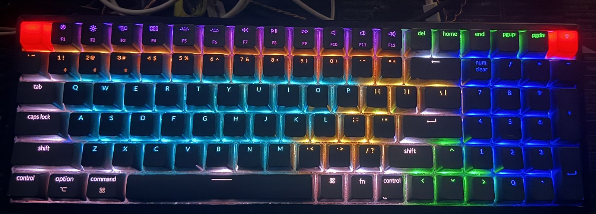

# QMK with working Bluetooth for the Keychron K4 V2 (RGB)



Custom [SonixQMK](https://github.com/SonixQMK/qmk_firmware) firmware for the
**Keychron K4 V2 RGB** that adds what upstream QMK was missing on this board:
**Bluetooth**. It also comes with VIA support, a lighting effect that colors
each key group differently (the photo above), and macOS scripts to back up,
flash and restore the stock firmware.

**Leer en español:** [GUIA-ES.md](GUIA-ES.md)

> Fork of [ephb/QMK-on-K4V2](https://github.com/ephb/QMK-on-K4V2). The original
> Windows guide is kept in [docs/ORIGINAL-GUIDE.md](docs/ORIGINAL-GUIDE.md).

## What you get

| Feature | Details |
|---|---|
| **Bluetooth** | 3 profiles, pairing, battery level on the number row, low-battery warning, auto sleep |
| **Mac / Windows switch** | The side switch selects a Mac layer or a Windows layer (Option/Command, macOS F-row functions) |
| **VIA** | Remap keys and change lighting from [usevia.app](https://usevia.app), no recompiling |
| **Zones lighting** | Default effect: each key group gets its own color. Pick the colors in VIA or use a ready-made palette, including Gaming and Code modes |
| **Safe install** | Scripts verify your stock firmware before flashing and can put it back at any time |

## Status

| | |
|---|---|
| ✅ Tested on real hardware | K4 V2 **ANSI** RGB, VIA build, macOS: wired typing, VIA, Zones lighting, Bluetooth pairing (profile 1) and typing over Bluetooth |
| ⚠️ Builds, not yet confirmed on hardware | Bluetooth profiles 2 and 3, battery gauge (Fn + B), sleep/wake, the **ISO** layout, Windows as the host, the Windows scripts (tested with a simulated flasher) |

If you try any of the untested parts, please open an issue and say how it went.

## Before you start

- **Keyboard:** K4 **V2 RGB**. The white-backlight version is not covered.
  Remove the space bar: the PCB should read `FK52332UB-G Ver10` and show two
  **BOOT** pads.
- **ANSI or ISO:** ANSI has a wide one-row Enter. ISO has a tall, upside-down "L"
  Enter and an extra key next to the left Shift (for example Spanish or UK layouts).
- **Computer:** a Mac (Apple Silicon or Intel) with [Homebrew](https://brew.sh)
  for the steps below. **On Windows, follow [Windows](#windows) instead**: no
  tools to install, just double-click. Linux: see [Linux](#linux).

> **Risk:** flashing always carries a small risk. The SN32F248B chip has its
> bootloader in ROM, so shorting the BOOT pads always lets you flash again,
> including the stock firmware. Use a good cable, don't unplug while flashing,
> and follow the steps in order.

## 1. Set up the tools (once)

```bash
git clone https://github.com/wilmermolinac/QMK-on-K4V2.git
cd QMK-on-K4V2
scripts/setup-macos.sh
```

This downloads everything into `build/` (ignored by git): SonixQMK at the
tested commit, the official QMK ARM toolchain, the QMK CLI in a Python
virtualenv, and [SonixFlasherC](https://github.com/SonixQMK/SonixFlasherC),
the command-line flasher. It only installs `libusb` and `pkgconf` through
Homebrew if they're missing.

## 2. Enter bootloader mode

1. Set the side switch to **Cable**.
2. Unplug the USB cable.
3. Remove the space bar and short the two **BOOT** pads (tweezers or a paper clip;
   touching both pads is enough).
4. Plug the cable in while still shorting the pads, then let go after 1–2 seconds.
   The keyboard lights stay off.

**How to tell it worked:** the keyboard lights stay off and it doesn't type.
To be sure, list the connected devices:

```bash
build/tools/SonixFlasherC/sonixflasher -c
```

You should see a line with `SONIX SN32F24XB` and `0c45  7040`. If that line isn't
there, unplug and try again: the pads have to be shorted at the moment you plug in.

> Once this firmware is installed you don't need to open the keyboard again:
> **Fn + Esc** enters the bootloader.

## 3. Back up the stock firmware

Do this **before** flashing anything:

```bash
scripts/backup-stock.sh
```

It never writes to the keyboard. The bootloader can't read the flash back over
USB, so the script does this instead:

1. Reads the chip's **flash checksum** and saves it to `backup/device-info-<date>.txt`.
2. Downloads the stock K4 V2 firmware (ANSI v1.07, ISO v1.01) from the SonixQMK
   database and checks its SHA-256.
3. If the checksums match, that file is **identical** to your firmware, and it's
   saved as `backup/MI_FIRMWARE_ORIGINAL.bin`.

**If it says "NO COINCIDE" (no match):** the stock firmware stores your lighting
settings in flash, which changes the checksum. Do a factory reset with
**Fn + J + Z** (hold about 3 seconds), go back to step 2 and run the backup again.
If it still doesn't match, you have a different firmware version: stop here and
keep Keychron's official updater for the K4 V2 as your way back.

Copy the `backup/` folder somewhere safe outside the repo too.

## 4. Build the firmware

> **Don't want to build?** Download the ready-made `.bin` for your layout from
> [Releases](https://github.com/wilmermolinac/QMK-on-K4V2/releases/latest) and
> skip to step 5. You still need step 1 (or another copy of SonixFlasherC) to flash it.

Pick one:

```bash
scripts/build.sh via       # recommended: works with VIA
scripts/build.sh           # plain QMK keymap (smaller, no VIA)
```

The files end up in `build/out/`, for example
`keychron_k4_rgb_v2_ansi_via.bin` and `keychron_k4_rgb_v2_iso_via.bin`.

## 5. Flash

With the keyboard in bootloader mode (step 2, or **Fn + Esc** once this firmware
is installed), flash the file that matches **your** layout:

```bash
scripts/flash.sh build/out/keychron_k4_rgb_v2_ansi_via.bin
```

The script asks you to type `si` ("yes"), flashes and checks the checksum. When
it finishes, unplug and plug the keyboard back in. On a Mac, if the Keyboard
Setup Assistant opens, choose your layout (ANSI or ISO).

The first boot after a new build resets the saved settings (lighting, VIA
keymap) to the defaults. That's expected.

## 6. Use VIA

1. Open **[usevia.app](https://usevia.app)** in **Chrome** or **Edge** (Safari can't
   talk to USB keyboards). Use the keyboard in **Cable** mode.
2. Go to **Settings** and turn on **Show Design tab**.
3. In the **Design** tab, load [`via/k4v2_ansi_via.json`](via/k4v2_ansi_via.json)
   (or [`via/k4v2_iso_via.json`](via/k4v2_iso_via.json)). The K4 V2 isn't in
   VIA's official list, so you have to load it every time you open VIA.
4. Click **Authorize device** and pick the keyboard.

You can now use:

- **Configure:** remap keys. Layers are **0 = Windows**, **1 = Mac**, **2 = Fn**
  (shared by both). In Mac mode, Fn + F1…F12 sends whatever layer 0 has on the
  F-row. The battery key is under *Custom* as **Batt**.
- **Lighting:** effect (all listed by name), brightness, speed, color and the
  per-group colors of **Zones: Custom**.

The VIA build has 3 layers instead of 4 because the chip only has 8 KB of RAM.

## 7. Keys and lighting

### Everyday keys

| Action | Keys |
|---|---|
| Switch Mac / Windows | Side switch **Mac / Win** |
| F1–F12 in Mac mode | **Fn** + F-row (without Fn: brightness, Mission Control, Launchpad, media, like stock) |
| Media in Windows mode | **Fn** + F-row |
| Bootloader (to flash) | **Fn + Esc** |
| Insert / Print Screen / Sleep | **Fn + Del / Home / PgDn** |

### Bluetooth

| Action | Keys |
|---|---|
| Use Bluetooth | Side switch on **BT** |
| Choose profile 1 / 2 / 3 | **Fn + 1 / 2 / 3** |
| Pair a new device | **Hold Fn + 1 / 2 / 3 for 3 s**: the key blinks blue. Pick the keyboard in your device's Bluetooth settings; the key turns solid blue when connected |
| Battery level | **Fn + B**: the number row fills up (green > 70 %, orange 30–70 %, red < 30 %) |
| Low battery | The profile key blinks red every 4 s |
| Power saving | Lights off after 10 min idle (40 s if not connected); any key wakes it |

### Lighting

| Change | Keys |
|---|---|
| Next effect (Shift = previous) | **Light key** (top right) |
| On / off | **Fn + light key** |
| Color | **Fn + numpad `-`** |
| Saturation | **Fn + numpad Enter** |
| Speed | **Fn + numpad `+`** |
| Brightness | Mac: **F5 / F6** · Windows: **Fn + F5 / F6** |

Hold **Shift** to go the other way. Settings are saved automatically.

### Zones effects

**Zones** gives each key group its own color. There are 8 versions; the light
key (or VIA's *Effect* list) goes through them:

| Effect | What it does |
|---|---|
| **Zones: Custom** (default) | Your own colors: pick one per group in VIA (see below). Starts as Classic |
| **Zones: Classic** | The colors in the photo (table below) |
| **Zones: Gaming** | Game keys stand out, everything else is dim (table below) |
| **Zones: Code** | Keys grouped by what they do when programming (table below) |
| **Zones: Ocean** | Blues, aquas and turquoise |
| **Zones: Sunset** | Reds, oranges, ambers and pinks |
| **Zones: Neon** | Bright magenta, yellow, cyan, green and purple |
| **Zones: Ice** | Blues with white letters |

Classic colors:

| Group | Color |
|---|---|
| Esc | Red |
| F1–F12 | Purple |
| Number row (`` ` `` 1–0 `-` `=`) | Orange |
| Letters A–Z | Cyan |
| Symbols (`[ ] \ ; ' , . /`, plus the extra ISO keys) | Yellow |
| Modifiers (Tab, Caps Lock, Shift, Ctrl, Win/Cmd, Alt/Opt, Fn, Enter, Backspace, Space) | White |
| Navigation (Del, Home, End, PgUp, PgDn, arrows) | Green |
| Numpad | Blue |
| Light key | Magenta |

**Gaming:**

| Keys | Color |
|---|---|
| W A S D (movement) | Red |
| Q E R F G (abilities, interact, reload) | Orange |
| 1–5 (weapons, items) | Yellow |
| Space, Left Shift, Left Ctrl, Left Alt (jump, sprint, crouch) | Cyan |
| Esc, Tab, T, Z X C V B, M, arrows (menus, chat, map, extra binds) | Soft blue |
| Everything else | Dim purple |

**Code:**

| Keys | Color |
|---|---|
| `[ ]` and `9 0` (for `{ }` and `( )`) | Magenta |
| Operators: `- = /` and numpad `/ * - +` | Yellow |
| Punctuation: `; ' , . \` and `` ` `` | Green |
| Editing: Backspace, Del, Enter, Tab, Space | White |
| Navigation: arrows, Home, End, PgUp, PgDn | Blue |
| Shortcuts: Ctrl, Win/Cmd, Alt/Opt, Shift, Fn, Caps Lock | Purple |
| Esc and the usual run/debug keys F5, F9–F12 | Red |
| Letters, 1–8, other F-keys, numpad digits | Soft, so the groups above stand out |

- **Brightness** works as usual in every Zones effect.
- In the **fixed palettes**, the global **Color** (Fn + numpad `-`, or VIA's
  *Color*) rotates the whole palette and **Saturation** fades it toward white.
  Set the hue back to 0 for the original colors.
- **Zones: Custom** shows exactly the colors you picked; the global color doesn't
  change it.

#### Pick your own colors in VIA

1. In VIA, open **Lighting** and choose **Zones: Custom (edit below)** as the effect.
2. Under **Zones colors** there's one color picker per group: Esc, F1-F12,
   Numbers, Letters, Symbols, Modifiers, Navigation, Numpad and Light key.
3. Change any of them: the keyboard updates right away and saves the colors
   about 1.5 s after your last change.

The colors survive unplugging. Flashing a new build resets them to Classic.

#### Change the groups or the fixed palettes (advanced)

Edit [`rgb_matrix_kb.inc`](firmware/keyboards/keychron/k4/rgb/v2/rgb_matrix_kb.inc):

- `k4v2_map_general`, `k4v2_map_gaming` and `k4v2_map_code` are the keyboard
  matrix (6 rows × 19 columns). Each entry says which group a key belongs to,
  for example `_W` for WASD in the Gaming map.
- `k4v2_pal_classic`, `k4v2_pal_gaming`, `k4v2_pal_code`… hold each palette as
  `{hue, saturation, brightness}` per group on QMK's 0–255 scale. Hue: 0 red,
  21 orange, 43 yellow, 85 green, 128 cyan, 170 blue, 191 purple, 213 magenta.
  Saturation 0 is white. Brightness 255 is full, lower values dim the group.

Then run `scripts/build.sh via` and flash again (step 5).

### Built-in effects

To keep the list short (and save memory), the firmware keeps these QMK effects:
Solid Color, Breathing, Cycle All, Cycle Left/Right, Rainbow Beacon, Raindrops,
Hue Wave, Reactive Simple (keys light up when pressed) and Splash. The list is in
[`post_config.h`](firmware/keyboards/keychron/k4/rgb/v2/post_config.h).

## 8. Go back to the stock firmware

Enter the bootloader (**Fn + Esc**, or short the BOOT pads) and run:

```bash
scripts/restore-stock.sh
```

It flashes `backup/MI_FIRMWARE_ORIGINAL.bin`. To force a specific version:
`scripts/restore-stock.sh ansi` or `scripts/restore-stock.sh iso`.

## Troubleshooting

- **Bluetooth doesn't pair or doesn't type:** write down what the profile key
  does (blinks blue? nothing?) and open an issue. Wired mode keeps working either way.
- **Ghost or repeated keys only over Bluetooth:** add
  `#define K4V2_MATRIX_SELECT_DELAY_US 20` to
  [`config.h`](firmware/keyboards/keychron/k4/rgb/v2/config.h), rebuild and flash.
- **Mac and Windows layers swapped:** add `#define K4V2_OS_SWITCH_DISABLE` to the
  same `config.h` and open an issue.
- **VIA says it can't find a V3 definition:** load the JSON from the `via/`
  folder in the Design tab (step 6.3).
- **Anything serious:** `scripts/restore-stock.sh`.

## Windows

The Windows scripts do the same as the macOS ones (backup, flash, restore) and
download the official [SonixFlasherC](https://github.com/SonixQMK/SonixFlasherC)
for Windows on first use, checking its SHA-256. They run on the PowerShell
that comes with Windows 10 and 11; nothing else to install.

> The Windows scripts were tested against a simulated flasher, not yet on a
> real Windows PC. If something fails, please open an issue with the message.

### Install with the Windows kit (no building)

1. Download **`K4V2-QMK-<version>-windows.zip`** from
   [Releases](https://github.com/wilmermolinac/QMK-on-K4V2/releases/latest) and
   unzip it (right-click → *Extract All*). Don't run it from inside the zip.
2. Put the keyboard in bootloader mode (see [step 2](#2-enter-bootloader-mode)):
   Cable mode, unplug, short the BOOT pads, plug in. The lights stay off.
3. **Back up:** double-click **`backup-stock.cmd`**. It never writes to the
   keyboard. Read the result as in [step 3](#3-back-up-the-stock-firmware):
   *MATCH* means `backup\MI_FIRMWARE_ORIGINAL.bin` is your stock firmware.
4. **Flash:** enter bootloader mode again and **drag the `.bin` for your
   layout** from the `firmware` folder **onto `flash.cmd`** (or double-click
   `flash.cmd` and pick the file). Type `yes`. When it's done, unplug and plug
   the keyboard back in.
5. **VIA:** same as [step 6](#6-use-via), with the JSON from the `via` folder.

To go back to the stock firmware: bootloader mode, then double-click
**`restore-stock.cmd`** (or run `restore-stock.cmd ansi` / `iso` from a
terminal to force a version).

If Windows SmartScreen warns about the `.cmd` files, choose *More info* → *Run
anyway*: they're plain text you can open in Notepad to check.

### Windows driver (only if the bootloader isn't found)

The flasher normally talks to the bootloader without installing anything. If
`backup-stock.cmd` or `flash.cmd` keeps saying *Bootloader not found* while
the keyboard is in bootloader mode (lights off):

1. Download [Zadig](https://zadig.akeo.ie).
2. With the keyboard in bootloader mode, open Zadig and choose
   *Options → List All Devices*.
3. Pick the device with USB ID **`0C45 7040`** (it's only there in bootloader
   mode), choose **WinUSB** and click *Install Driver*.

This only affects the bootloader (`0C45:7040`), not the keyboard in normal use.

### Build on Windows (optional)

Only if you changed the firmware (for example the [Zones palettes](#change-the-groups-or-the-fixed-palettes-advanced)):

1. Install [QMK MSYS](https://msys.qmk.fm) and open the **QMK MSYS** console.
2. Download this repo and prepare SonixQMK:

   ```bash
   git clone https://github.com/wilmermolinac/QMK-on-K4V2.git
   cd QMK-on-K4V2
   scripts/setup-sonixqmk.sh
   ```

3. Build: `scripts/build.sh via` (files in `build/out/`).
4. Flash from File Explorer: drag `build\out\keychron_k4_rgb_v2_ansi_via.bin`
   onto `scripts\windows\flash.cmd`. Back up first with
   `scripts\windows\backup-stock.cmd`.

## Linux

With [QMK installed](https://docs.qmk.fm/newbs_getting_started) (`qmk setup`
gives you the ARM compiler), the same scripts work:

```bash
scripts/setup-sonixqmk.sh
scripts/build.sh via
```

To back up and flash, build [SonixFlasherC](https://github.com/SonixQMK/SonixFlasherC)
(or download its Linux release) and use it as in the macOS steps:
`sonixflasher -v 0c45/7040 -i` to read the checksum (compare it with the stock
checksums in [`scripts/common.sh`](scripts/common.sh)) and
`sonixflasher -v 0c45/7040 -f <file>.bin` to flash. You may need a udev rule
or `sudo` to access the bootloader.

## How the Bluetooth works

The K4 V2's Bluetooth is a separate ITON module that talks to the SN32F248B
over SPI.

- **Transport** ([`k4v2_bt.c`](firmware/keyboards/keychron/k4/rgb/v2/k4v2_bt.c)):
  ported from the Keychron **K3 V2**
  ([SonixQMK PR #501](https://github.com/SonixQMK/qmk_firmware/pull/501)), which
  copies the stock firmware's protocol. The K3 V2 and K4 V2 share the same chip
  and SPI peripheral.
- **Keyboard logic** ([`v2.c`](firmware/keyboards/keychron/k4/rgb/v2/v2.c)):
  profiles, pairing, battery and sleep, based on the K3 V2 and on the K4 V2 work in
  [SonixQMK PR #486](https://github.com/SonixQMK/qmk_firmware/pull/486).
- It plugs into QMK's `custom` Bluetooth driver, so wired and Bluetooth follow
  the side switch.

## Repository layout

| Path | Contents |
|---|---|
| `firmware/keyboards/keychron/k4/rgb/v2/` | Files copied on top of SonixQMK: Bluetooth driver, board logic, keymaps, Zones effect |
| `via/` | VIA definitions for ANSI and ISO |
| `scripts/` | macOS setup, build, backup, flash and restore; `setup-sonixqmk.sh` for QMK MSYS / Linux; `make-release.sh` packs a release |
| `scripts/windows/` | Windows backup, flash and restore (`.cmd` + PowerShell) |
| `GUIA-ES.md` | Full guide in Spanish |
| `docs/ORIGINAL-GUIDE.md` | ephb's original Windows guide |

## Credits

- [ephb](https://github.com/ephb/QMK-on-K4V2): the original K4 V2 guide and port.
- [dexter93](https://github.com/dexter93) and the [SonixQMK](https://github.com/SonixQMK) team.
- mgrenonville: K3 V2 Bluetooth transport (SonixQMK PR #501).
- reubenjs: K4 V2 Bluetooth integration (SonixQMK PR #486).
- 1Conan: the original ITON driver.
- PythonDeployer: K4 V2 ANSI port.

The firmware code is GPL-2.0-or-later, like QMK.
